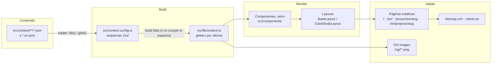

# agustinmusanti.github.io

Portfolio personal de Agustín Musanti — Data & Reporting Analyst. Sitio estático bilingüe (ES/EN) construido con Astro, con todo el contenido validado por esquemas Zod, deploy automático a GitHub Pages y una suite de CI (tipos, lint, E2E, accesibilidad, link-checking, Lighthouse).

**Sitio:** https://agustinmusanti.github.io

## Stack

- [Astro](https://astro.build) (salida 100% estática) + TypeScript strict.
- [Tailwind CSS v4](https://tailwindcss.com) vía el plugin de Vite, combinado con tokens de diseño en CSS custom properties (`src/styles/global.css`) para el tema claro/oscuro.
- Fuentes self-hosted con `@fontsource` (Space Grotesk, Inter, JetBrains Mono) — nada de Google Fonts por CDN.
- Islas de JS vanilla (sin frameworks de UI) para el toggle de tema, el filtro de proyectos, los contadores animados, el command palette y el botón de copiar email.
- Content Collections de Astro con esquemas Zod como única fuente de verdad del contenido.
- `satori` + `@resvg/resvg-js` para generar las imágenes Open Graph en build-time.
- Playwright (E2E) + `@axe-core/playwright` (accesibilidad), `lychee` (link checking) y Lighthouse CI.

## Arquitectura: de JSON a página



Si un archivo de contenido no cumple su esquema, `astro build` falla antes de generar una sola página: el contenido nunca llega "roto" a producción.

## Cómo editar contenido

**Nunca se edita HTML/JS para cambiar texto.** Todo el contenido vive en `src/content/`:

| Qué                                              | Dónde                                             |
| ------------------------------------------------ | ------------------------------------------------- |
| Perfil, bio, tagline                             | `src/content/profile/profile.json` (+ `.en.json`) |
| Contadores de impacto                            | `src/content/impact/impact.json`                  |
| Experiencia (timeline)                           | `src/content/experience/experience.json`          |
| Proyectos profesionales (PwC, anonimizados)      | `src/content/projects/professional.json`          |
| Proyectos personales (uno por archivo = un slug) | `src/content/projects/personal/*.json`            |
| Reconocimientos                                  | `src/content/recognitions/recognitions.json`      |
| "Cómo aprendo" + "Ahora estoy construyendo"      | `src/content/learning/learning.json`              |
| Stack / herramientas                             | `src/content/stack/stack.json`                    |
| Config del sitio (CV, analytics, foto)           | `src/content/config/site.json`                    |

Cada archivo en español tiene un espejo `*.en.json` con la traducción (misma estructura e IDs). El esquema de cada colección está en `src/content.config.ts`; si agregás un campo nuevo, agregalo ahí primero.

### Cómo agregar un proyecto personal

1. Creá `src/content/projects/personal/mi-proyecto.json` (el nombre del archivo es el slug) y su espejo en `src/content/projects/personal-en/mi-proyecto.json`.
2. Completá `title`, `description`, `tags`, `order`, `stack`, y opcionalmente `repo`, `demo`.
3. Si querés una página de caso (`/proyectos/mi-proyecto`), agregá el bloque `caseStudy` con `problem`, `approach`, `result`, `learnings` (en ambos idiomas). Sin ese bloque, el proyecto aparece solo como tarjeta.
4. Si el proyecto tiene `repo` en GitHub, las estrellas y la fecha de actualización se obtienen en build-time (`src/lib/github.ts`); si la API falla o hay rate limit, el build no se rompe, solo se omite ese dato.

## Desarrollo local

Requiere Node 20+ (probado con Node 22/24).

```bash
npm install
npm run dev
```

Comandos principales:

| Comando                           | Qué hace                                                    |
| --------------------------------- | ----------------------------------------------------------- |
| `npm run dev`                     | Server de desarrollo en `localhost:4321`                    |
| `npm run build`                   | Build estático a `dist/` (incluye las imágenes OG)          |
| `npm run preview`                 | Sirve el build de `dist/`                                   |
| `npm run check`                   | `astro check` — tipos + validación de esquemas de contenido |
| `npm run lint`                    | ESLint (Astro + TypeScript)                                 |
| `npm run format` / `format:check` | Prettier (con soporte para `.astro`)                        |
| `npm run test:e2e`                | Playwright (E2E + accesibilidad con axe-core)               |

## CI/CD

- **`.github/workflows/ci.yml`** corre en cada PR y push a `main`: tipos/esquemas (`astro check`), lint, format check, build, Playwright (navegación, tema sin flash, filtro de proyectos, copiar email, command palette, versión `/en/`) + axe-core sin violaciones serias/críticas, link checking con `lychee` sobre el build, y Lighthouse CI con budgets de ≥95 en las 4 categorías (mobile).
- **`.github/workflows/deploy.yml`** reutiliza el CI como gate: si pasa, hace build y deploya a GitHub Pages con `actions/deploy-pages` en cada push a `main`.

### Activar GitHub Pages

En el repo: **Settings → Pages → Build and deployment → Source: GitHub Actions**. No hace falta configurar nada más; `deploy.yml` ya apunta a Pages vía `actions/deploy-pages`.

## Decisiones técnicas

- **Sin framework de UI (React/Vue/etc.)**: todas las islas interactivas son Web Components-style vanilla JS embebidas en componentes `.astro`, para mantener el JS enviado al cliente mínimo.
- **Content Collections con loaders `file()`/`glob()`** en vez de Markdown: el contenido es estructurado (objetos, no prosa), así que JSON + Zod da validación de tipos real en build sin una capa extra de parsing.
- **i18n con archivos paralelos `*.en.json`** en vez de una librería de i18n: con 9 colecciones y contenido mayormente estructurado, duplicar el archivo por idioma es más simple de mantener y de revisar (diff directo) que anidar `{es, en}` dentro de cada campo.
- **Ilustraciones SVG genéricas por categoría de tags** (no capturas) para los proyectos: cumple el requisito de "diagrama, no foto" sin tener que diseñar una ilustración única por cada uno de los 11 proyectos.
- **Paleta ajustada tras medir contraste**: el dorado de acento en tema claro se oscureció de `#A86F0C` a `#8C5E0A` porque el original no llegaba a 4.5:1 (WCAG AA) contra el fondo crema en texto chico; se verificó con un cálculo de luminancia relativa, no a ojo.

## Pendientes conocidos

- Foto de perfil (`public/img/agustin.jpg` o `src/assets/agustin.jpg`): mientras no exista, se muestra un placeholder con las iniciales "AM".
- CV en PDF (`public/cv/CV_AgustinMusanti.pdf`): el botón de descarga está oculto por la flag `cv.enabled` en `src/content/config/site.json` hasta que se suba el archivo.
